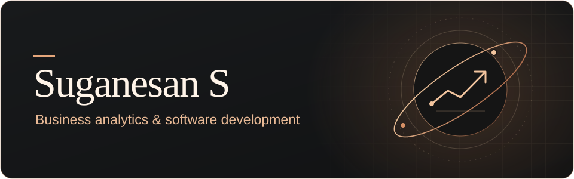

**MBA in Business Analytics & Marketing · BIT Sathy**  
Coimbatore, Tamil Nadu, India

I build apps and dashboards that help teams run day-to-day operations and understand how they’re performing.

## Featured project

### HOOT

An offline file converter that handles images, documents, and media directly on your device. Built with C# and Avalonia, HOOT pairs a drag-and-drop conversion wheel with clipboard detection.

[**Explore HOOT →**](https://github.com/sugan0025/HOOT) · [**Download a release →**](https://github.com/sugan0025/HOOT/releases)

## Selected work

| Project | What I built |
| :--- | :--- |
| [**The Rolling Oven**](https://github.com/sugan0025/the-rolling-oven) | A direct-to-consumer bakery storefront with GA4 instrumentation and server-side price validation. |
| [**ClaudeCounter**](https://github.com/sugan0025/Sugan-s-ClaudeCounter) | A browser overlay for Claude.ai that tracks token usage and rate limits and exports session data. |
| [**One Smart Era**](https://github.com/sugan0025/one-smart-era) | A Flutter app for civic grievance tracking and farmer assistance, including crop disease identification and agricultural market prices. |
| **Faculty Guide Selection** | A faculty selection platform for BIT Sathy’s MBA program. Uses PostgreSQL row locks to handle simultaneous selections and syncs results to Google Sheets. |

## Analytics & operations

- **Placement analytics at BIT Sathy.** As MBA Placement Coordinator for the 2025–2027 cohort, I built a placement tracking system and group discussion dashboard to monitor students’ progress through recruitment.
- **Retail business intelligence.** Built Power BI dashboards with DAX measures for cohort retention and revenue analysis.
- **Industrial operations at Roots Industries.** Automated time-and-motion studies and built employee training trackers for the Horn Division.

## Toolkit

**Analytics** · Power BI, DAX, Python, Excel/VBA, GA4  
**Development** · C#, Avalonia, Next.js, TypeScript, PostgreSQL, Flutter

I hold a B.Com in Accounting & Finance and served as Co-Coordinator of MANFEST 2026. I’m open to business analyst roles, growth engineering consulting, and analytics collaborations.

[**Browse my repositories →**](https://github.com/sugan0025?tab=repositories)
